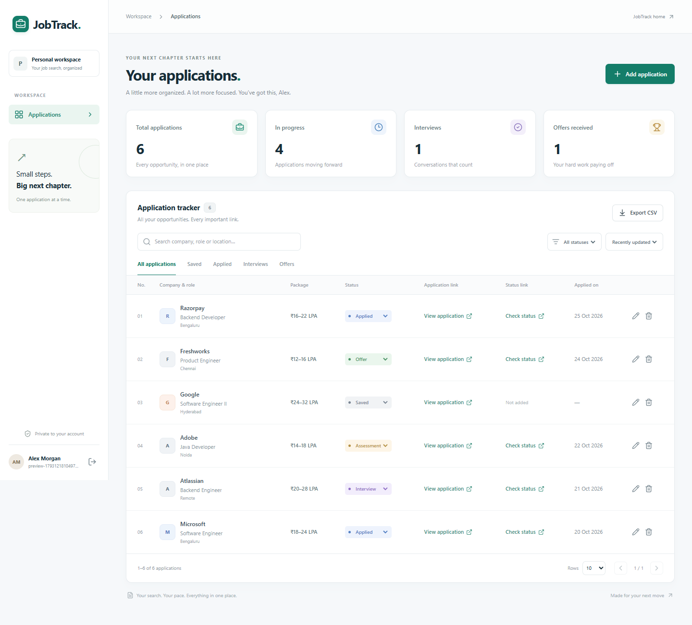
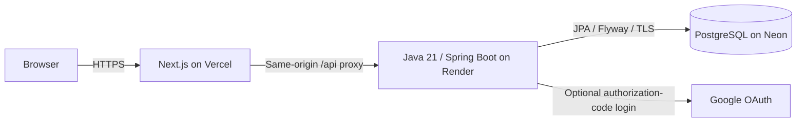

# JobTrack

A focused job application tracker built with **Next.js, TypeScript, Java 21, Spring Boot, and PostgreSQL**. Keep the link you applied through and the link you use to check your application status in the same place.

The interface is intentionally small: a public home page, Google or email/password sign-in, and a private applications workspace. Each person gets their own account and records. Signing up with a Gmail address does **not** require Google OAuth; it works like any email/password account.



[View the home page design](docs/images/home.png). The screenshot uses a separate demonstration account; new accounts start empty.

## What you can do

- Add, edit, and delete applications without switching between spreadsheets and browser bookmarks.
- Track company, role, package, status, application link, and status-check link, with optional location, work mode, dates, and notes.
- Change an application status directly from the workspace.
- Search and filter records, sort results, and move through paginated applications.
- See application totals, active applications, interviews, and offers.
- Export your applications to CSV.
- Sign in using email/password or Google when the deployment owner configures Google credentials.

Statuses: **Saved, Applied, Assessment, Interview, Offer, Rejected, Withdrawn**. New accounts start empty; the home-page example is illustrative.

## Architecture



The browser always calls `/api` on the website's own domain. Next.js forwards those requests to `BACKEND_URL`. The Java API handles authentication, validation, authorization, persistence, and CSV generation. Database credentials and Google secrets belong on the backend only.

Local development uses a persistent H2 database in PostgreSQL compatibility mode, so you can start without Docker, a cloud account, or a database installation. The production profile requires PostgreSQL. Flyway manages schema changes; Hibernate validates the schema instead of creating or overwriting it.

## Run on your laptop

Install **Node.js 22.12 or newer** and **OpenJDK 21**. Maven is downloaded automatically by the included wrapper. The first run needs internet access for dependencies.

From the repository root:

```sh
npm ci
npm run dev:all
```

Open **http://localhost:3000**. The Java API runs at **http://localhost:8080/api/health**. Create an account from the website; no seeded credentials are necessary. Press **Ctrl+C** to stop both processes.

The starter detects `JAVA_HOME` from the installed Java runtime if it is unset. On Windows you can also use:

```powershell
.\scripts\start-local.ps1
```

For optional settings, copy root `.env.example` to `.env.local` and `backend/.env.example` to `backend/.env`. The starter reads the backend file as plain `KEY=value` settings. Environment variables already set in the shell take precedence. Next.js reads `.env.local` itself.

To run the services separately, open two terminals:

```powershell
# Terminal 1 — Windows; JAVA_HOME must point to your JDK
cd backend
.\mvnw.cmd spring-boot:run

# Terminal 2 — repository root
npm run dev
```

```sh
# Terminal 1 — macOS/Linux
cd backend
sh ./mvnw spring-boot:run

# Terminal 2 — repository root
npm run dev
```

When launching Maven directly, export optional backend environment variables in that terminal: Maven does not automatically load `backend/.env`. Local records live under `backend/data/` when launched using the starter. Keep that directory if you want to keep your data.

### Optional Docker setup

```sh
docker compose up --build
```

This starts the frontend, Java API, and PostgreSQL. Open http://localhost:3000. Data persists in the named `jobtrack-postgres` volume. `docker compose down` stops the stack without deleting that volume. The Compose file uses a local development password and HTTP cookie settings; use the deployment guide for public hosting.

## Deploy with free tiers

**Vercel hosts the frontend; it does not run this Spring Boot server.** Use the included Render Docker configuration for Java and a Neon Free PostgreSQL database. No paid AI, scraping, or storage service is required.

Follow **[the deployment guide](docs/DEPLOYMENT.md)** in order. It covers Vercel, Render, Neon, Google OAuth, environment variables, and a real-user acceptance checklist. Hosting is not activated by cloning the code: the owner must create the accounts, enter credentials, and deploy the services.

| Service | Purpose | Important free-tier limit |
| --- | --- | --- |
| [Vercel Hobby](https://vercel.com/docs/plans/hobby) | Next.js website and API proxy | Personal, non-commercial use and usage allowances |
| [Render Free](https://render.com/docs/free) | Java Docker web service | Sleeps after inactivity; the next visit can take about a minute to wake it |
| [Neon Free](https://neon.com/pricing) | Durable PostgreSQL database | Storage and compute allowances; review current limits before deployment |

Free tiers are suitable for a personal portfolio and light use, with no always-on availability guarantee. Providers can change their terms. Check the linked plans, select **Free**, and do not enable paid upgrades or add-ons. Render's free filesystem is ephemeral, which is why production data belongs in Neon. Render's free PostgreSQL offering expires after 30 days and is not used by this configuration. [Render free-service documentation](https://render.com/docs/free)

## Configuration

| Location | Variable | Value |
| --- | --- | --- |
| Frontend | `BACKEND_URL` | `http://localhost:8080` locally; your HTTPS Render URL in production, no trailing slash |
| Backend | `APP_URL` | Exact frontend origin, e.g. `https://your-project.vercel.app` |
| Backend | `SPRING_PROFILES_ACTIVE` | Set to `prod` on Render; omit for local H2 |
| Backend | `JDBC_DATABASE_URL` | Production JDBC PostgreSQL URL including TLS, without embedded credentials |
| Backend | `DATABASE_USERNAME`, `DATABASE_PASSWORD` | PostgreSQL credentials, backend only |
| Backend | `GOOGLE_CLIENT_ID`, `GOOGLE_CLIENT_SECRET` | Optional Google web application OAuth client |
| Backend | `RESEND_API_KEY`, `EMAIL_FROM` | Optional password-reset email delivery with an authorized sender |
| Backend | `DEV_EMAIL_LOG` | Optional local reset-link logging; always disabled in production |
| Backend | `COOKIE_SECURE` | `false` locally; production forces secure cookies |
| Backend | `PORT` | Hosting-provided server port; defaults to `8080` |

Never prefix database passwords or Google secrets with `NEXT_PUBLIC_`. Keep `.env`, `.env.local`, and `backend/.env` out of Git. Google and password reset expose availability through `/api/auth/config`; email/password sign-up does not depend on either service.

## Verify the project

```sh
# Repository root
npm run typecheck
npm test
npm run build

# Java API — macOS/Linux
cd backend
sh ./mvnw verify
```

```powershell
# Java API — Windows
cd backend
.\mvnw.cmd verify
```

The frontend has **four unit tests** and **four browser workflows** covering registration, application CRUD, saved links, status changes, filtering, export, logout/login, mobile layout, and protected routes. **Eight Java integration tests** exercise real controller/security behavior and migrations against H2 locally. GitHub Actions is configured to run the Java suite against **PostgreSQL 17** and the browser workflows against a complete local Java/Next.js stack on every push and pull request.

Run browser tests while `npm run dev:all` is running in another terminal:

```sh
# CI/Linux uses Playwright's installed Chromium
npx playwright install --with-deps chromium
CI=true npm run test:e2e
```

For Windows local testing, the Playwright configuration uses installed Google Chrome:

```powershell
npm run test:e2e
```

If Chrome is unavailable, use Playwright Chromium instead:

```powershell
npx playwright install chromium
$env:CI = 'true'
npm run test:e2e
```

Browser reports appear under `playwright-report/`; failed runs retain screenshots and traces. Google login and the hosted deployment still need the owner's credentials and the deployment checklist; local tests do not substitute for a real OAuth callback.

See **[API documentation](docs/API.md)** for request formats, status values, pagination, and error responses.

## Security and privacy

- Passwords are hashed with BCrypt. Session cookies are HttpOnly, SameSite=Lax, and Secure in production.
- Session tokens are random; only their hashes are stored in the database. Logout revokes the session.
- Application reads, changes, and exports are scoped to the signed-in user. IDs do not grant access to another person's records.
- Unsafe requests are checked against the configured website origin. Keep `APP_URL` exact, especially after changing domains.
- Google login uses authorization-code exchange, state validation, and verified Google email information. Existing password accounts are not silently merged by an unverified email match.
- User-entered links accept HTTP/HTTPS only. CSV export escapes values and neutralizes spreadsheet formulas.
- Basic authentication throttling limits repeated requests; it is per backend instance, not a distributed abuse-prevention service.

Email/password registration does not verify ownership of the email address. Google verifies its own accounts. Enable reset-email delivery for a public deployment if you want password recovery; otherwise that feature stays unavailable. The application does not read Gmail messages or submit applications on a user's behalf. Treat saved job notes and application URLs as private data, and use a dedicated database for this project.

## Repository map

```text
src/app/              Next.js routes and shared layout
src/components/       Public pages, auth, and applications interface
src/lib/              Frontend API helpers and shared types
backend/              Spring Boot API, migrations, Maven wrapper, Java tests
docs/                 Deployment and API guides
scripts/              Local startup helpers
render.yaml           Free Java service blueprint
vercel.json           Next.js deployment configuration
compose.yaml          Optional local PostgreSQL/Java/Next.js stack
.github/workflows/    Frontend and backend verification
```

This version replaces the original Prisma/Next.js backend with Java and narrows the product to application tracking. It uses a new database schema; legacy Prisma data is not automatically migrated.

## Describing this project on a resume

Use claims you can demonstrate in your deployed version:

- Built a full-stack job application tracker using Java 21, Spring Boot, Next.js, TypeScript, and PostgreSQL, with Google OAuth and cookie-based authentication.
- Implemented owner-scoped REST APIs, server-side pagination and filtering, Flyway migrations, and safe CSV export with automated security and integration tests.
- Configured a split deployment with Vercel and a Dockerized Java backend, environment-based secrets, and GitHub Actions verification.

Add your own measured usage or performance figures only after collecting them. Do not claim production scale, uptime, or completed cloud deployment from the source code alone.
